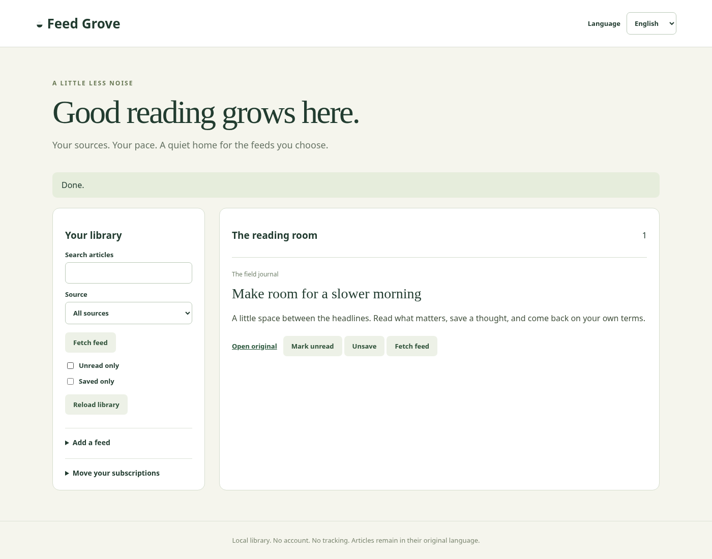

# Feed Grove


An open-source, local Feedly alternative for RSS/Atom reading, OPML migration, and saved articles. **Source published; local preview.**


The working component currently covers local RSS 2.0 / Atom 1.0 ingestion, OPML subscription migration, literal text filters, and persistent read/starred state. The responsive reader includes English, German, Spanish, Japanese, Simplified Chinese and Traditional Chinese. Article content stays in its original language; technical diagnostics fall back to English.

## Open your reading room

Requires Python 3.10+. Extract the package, then run:

```sh
python3 -m venv .venv
.venv/bin/pip install -r requirements.txt
.venv/bin/python server.py
```

Open **http://127.0.0.1:5142**. Add a public RSS/Atom URL and choose Fetch feed, or import downloaded UTF-8 XML at that URL. Use Move your subscriptions to preview an OPML file before importing. Select a source to refresh it. Mark articles read or saved, search, and export subscriptions. Stop the server with Ctrl+C. Back up `feed-grove.sqlite3` while the server is stopped.

This server binds only to loopback. It is a single-user local application, not a public multi-user service. Do not expose it through a reverse proxy. No accounts, cloud sync, AI ranking, full-article scraping or background polling.

## Optional ingestion CLI

Requires Python 3.10+ and the pinned dependency in `requirements.txt`.

```sh
python3 -m venv .venv
.venv/bin/pip install -r requirements.txt
.venv/bin/python -m unittest discover -s tests -v
.venv/bin/python cli.py --db reading.sqlite3 import-opml subscriptions.opml
.venv/bin/python cli.py --db reading.sqlite3 ingest https://example.com/feed feed.xml
.venv/bin/python cli.py --db reading.sqlite3 refresh https://example.com/feed
.venv/bin/python cli.py --db reading.sqlite3 list --unread
.venv/bin/python cli.py --db reading.sqlite3 export-opml > subscriptions-backup.opml
```

Supply your own exported OPML and downloaded feed XML. `ingest` does not make a network request. Run `mark URL KEY --read yes --starred yes` using the URL and key from `list`. `list --query word` searches titles and summaries; `--starred` filters saved entries. Reimporting a subscription leaves its existing folder intact. OPML exports subscriptions and folders, **not article content or reading state**; stop writers and back up the SQLite file for those.

Inputs are capped at 2 MiB, 2,000 entries per feed, and 500 unique subscriptions per OPML import. DTDs/entities, credentials in URLs, and unsupported document types are rejected. Feed HTML becomes inert plain text, unsafe article links are removed, and parameterized SQLite writes preserve flags during updates. No feed images, scripts, or external assets are loaded. RSS 1.0/RDF, enclosure downloads, full-article extraction, and date normalization are not implemented.

`refresh URL` downloads and ingests one public feed atomically. It allows ports 80/443, rejects non-public DNS answers and HTTPS downgrades, pins the checked connection address, verifies TLS, follows at most four redirects and caps the response at 2 MiB with a 20-second deadline (DNS gets at most five seconds per hop). Compressed responses are rejected; proxies, cookies and credentials are not used. A failed fetch or parse leaves stored entries unchanged. Use `ingest` with a local XML file if a feed requires unsupported transport.

## Validation limits

1. Validate public HTTP(S) refresh outside this workspace: direct DNS failed here. Automated address/redirect/TLS/size/deadline tests pass; this is not live-network acceptance.
2. Native-speaker review and actual Feedly-export compatibility; synthetic OPML and six-locale browser checks pass.
3. Local browser acceptance passes for import, reading state, filters, OPML export and mobile layout. Public deployment is not supported.
4. Source is published at https://github.com/anshuman-pandey/feed-grove. This is a local application; source publication does not imply a hosted reader.

Read [scope and distribution](docs/SCOPE.md) for the intended workflow and primary-source comparison. MIT licensed.

## Browser checks

```sh
npm ci
npx playwright install chromium
PATH="$PWD/.venv/bin:$PATH" npm run test:browser
```

Set `CHROMIUM_PATH` to an installed Chromium executable when needed. The test runner creates a disposable SQLite library and loopback server. It uses synthetic documents; no real user reading data is needed.

## Current verification

See the [26 November audit checkpoint](docs/AUDIT.md) for the verified repository, release links, fresh core test result and remaining deployment/browser gates. Earlier validation records remain dated evidence.

## Storage and live-feed checks

If the CLI reports “Library unavailable”, check that the database parent directory exists and is writable and that the file is a valid SQLite database. Keep the original file and backups; the CLI does not repair or replace a damaged library.

Run `python scripts/check_live_feed.py` to exercise the public Python.org RSS feed in a disposable library. It checks two refreshes, deduplication, saved/read state after reopening, and OPML subscription export. The same opt-in check is available under Actions → Public feed acceptance → Run workflow. It uses no existing library or credentials. A passing run covers this one feed only; it does not establish compatibility with every publisher or Feedly export.
